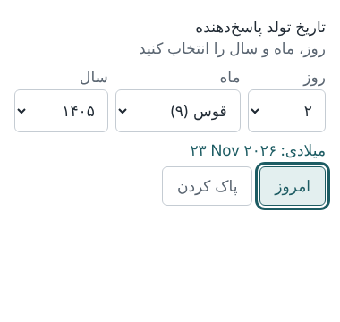
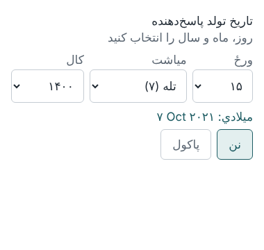

# Afghan date (Solar Hijri) field plug-in for SurveyCTO

A SurveyCTO field plug-in that lets enumerators enter dates in the Afghan Solar Hijri calendar, with the Afghan month names (Hamal, Sawr, Jawza … Hoot), and saves the result as a Gregorian date, an Afghan date, or both.

| Dari | Pashto |
|---|---|
|  |  |

## Features

- Day, month and year dropdowns with Afghan month names in Dari, Pashto or English
- Right-to-left layout and Persian digits (۱۴۰۵) for Dari and Pashto
- Shows the Gregorian equivalent under the picker so enumerators can double-check
- Handles leap years: 30 Hoot only appears in leap years, and invalid days are cleared when the month or year changes
- Works offline in SurveyCTO Collect; no external libraries or network calls
- Optional Today and Clear buttons
- Supports read-only fields and restores saved answers when the form is reopened

## Installation

1. Download `afghan-date.fieldplugin.zip` from the [releases](../../releases) page, or zip the plug-in files yourself (see [Building](#building)).
2. Attach it to your form definition on your SurveyCTO server.
3. In your form, use a field of type `text` with this in the appearance column:

```
custom-afghan-date
```

SurveyCTO only allows field plug-ins on `text`, `integer`, `decimal`, `select_one` and `select_multiple` fields, so this plug-in uses a `text` field rather than a `date` field.

## Parameters

All parameters are optional and go inside the parentheses in the appearance column.

| Parameter | Values | Default | What it does |
|---|---|---|---|
| `save` | `'gregorian'`, `'afghan'`, `'both'` | `'gregorian'` | Format of the saved value (see below) |
| `labels` | `'dari'`, `'pashto'`, `'english'` | From the form language | Language of month names, captions and buttons |
| `digits` | `'persian'`, `'latin'` | `'persian'` for Dari and Pashto, `'latin'` for English | Digits shown in the picker |
| `min_year` | An Afghan year, e.g. `1320` | `1300` | Earliest year in the year list |
| `max_year` | An Afghan year, e.g. `1406` | The current Afghan year | Latest year in the year list |
| `today` | `'no'` | Shown | Hides the Today button |

Example:

```
custom-afghan-date(save='both', min_year=1320, today='no')
```

When `labels` is not set, the plug-in looks at the name of the form's current language: names containing "Dari", "Farsi" or "Persian" give Dari, names containing "Pashto" give Pashto, and anything else gives English.

### Saved formats

| `save` | Saved value | Notes |
|---|---|---|
| `'gregorian'` | `2026-11-23` | Works directly with `date(${field})` |
| `'afghan'` | `1405-09-02` | Year-month-day in the Afghan calendar |
| `'both'` | `2026-11-23 1405-09-02` | Split with `selected-at()` |

Choose one format per field and keep it for the whole data collection, otherwise your export will have mixed formats.

## XLSForm examples

**Date of birth, saving both formats**

| type | name | label | appearance | constraint |
|---|---|---|---|---|
| text | dob | Respondent date of birth | `custom-afghan-date(save='both', today='no')` | `date(selected-at(., 0)) <= today()` |
| calculate | dob_greg | | | |
| calculate | dob_afghan | | | |

with these calculations:

```
dob_greg:   selected-at(${dob}, 0)
dob_afghan: selected-at(${dob}, 1)
```

**Future date, saving Gregorian only**

| type | name | label | appearance | constraint |
|---|---|---|---|---|
| text | next_visit | Date of next visit | `custom-afghan-date(max_year=1406)` | `date(.) >= today()` |

A complete test form is included as `afghan_date_test_form.xlsx`.

## Month names

| # | English | Dari | Pashto | Days |
|---|---|---|---|---|
| 1 | Hamal | حمل | وری | 31 |
| 2 | Sawr | ثور | غویی | 31 |
| 3 | Jawza | جوزا | غبرگولی | 31 |
| 4 | Saratan | سرطان | چنگاښ | 31 |
| 5 | Asad | اسد | زمری | 31 |
| 6 | Sunbula | سنبله | وږی | 31 |
| 7 | Mizan | میزان | تله | 30 |
| 8 | Aqrab | عقرب | لړم | 30 |
| 9 | Qaws | قوس | لیندۍ | 30 |
| 10 | Jadi | جدی | مرغومی | 30 |
| 11 | Dalw | دلو | سلواغه | 30 |
| 12 | Hoot | حوت | کب | 29, or 30 in a leap year |

## Accuracy

The Afghan calendar uses the same Solar Hijri rules as the Iranian calendar, with different month names. Conversion uses the algorithm from [jalaali-js](https://github.com/jalaali/jalaali-js) and was checked against the ICU Persian calendar for every day from 1925 to 2075 with no mismatches.

## Files

| File | Purpose |
|---|---|
| `manifest.json` | Plug-in metadata |
| `template.html` | Field layout |
| `style.css` | Styles |
| `script.js` | Picker logic and SurveyCTO integration |
| `cal.js` | Solar Hijri ↔ Gregorian conversion |

## Building

Zip the five plug-in files with no subfolders, and give the zip a name ending in `.fieldplugin.zip`:

```bash
zip -j afghan-date.fieldplugin.zip manifest.json template.html style.css script.js cal.js
```

## Limitations

- Images, audio and video from the `media` columns are not displayed on the question.
- The Today button uses the device's date, so it is only as accurate as the device clock.
- Supported years are 1178 to 3177 in the Solar Hijri calendar.

## Contributing

Issues and pull requests are welcome. Please test changes in SurveyCTO Collect on Android and in web forms before submitting.

## License

MIT. The calendar conversion is based on jalaali-js, which is also MIT licensed.
